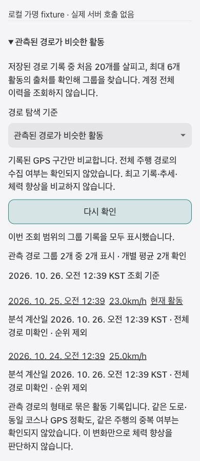

# Native observed route groups · local UI evidence

BE contract: miranae/orider-g1-web#3381. Parent epic: miranae/orider-g1-app#2882; R5: miranae/orider-g1-web#3374.

2026-10-26, Korean, Chrome 390×844, actual ActivityMatchedRouteGroupPanel + production design-system CSS, local fictional hook responses. Explicitly selected observed_native then clicked query. Result preserves activity links/individual average units and displays unconfirmed whole-ride coverage; comparison chart, fastest badge and trend section are absent. Document width and scrollWidth both 390px. Screenshot contains no private activity data.

The default remains complete; only native source offers the opt-in selector. Selecting another policy resets the request scope and discards stale responses. Stage runtime/owner/account/App Check service checks are unchanged. The service validates matching response policy, unproven coverage and zero rankings; cursor pages repeat the selected policy.

This fixture does not verify deployed HTTP/App Check, Firestore rules, populated production indices, or actual activity navigation. No stage gate was relaxed and no deployment was performed. Full R5 completion still needs source completeness evidence and index population operations.

Validation: 61 targeted tests, `tsc -b`, `lint:budget`, `quality:budget` passed. Standard build initially stopped because the reused local environment omitted VITE_ORIDER_AI_API_BASE; build then passed with an explicit local-only `http://127.0.0.1:5001` value. This built artifact is not deployment configuration and was not deployed. Prepared local dependency cache supplies hls.js missing from the primary checkout cache.
