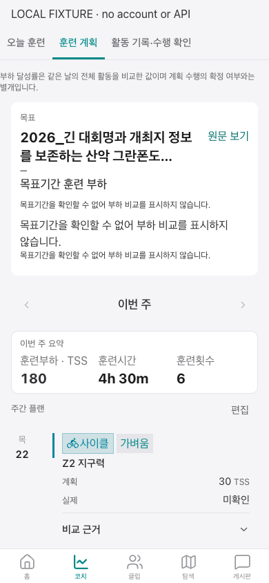
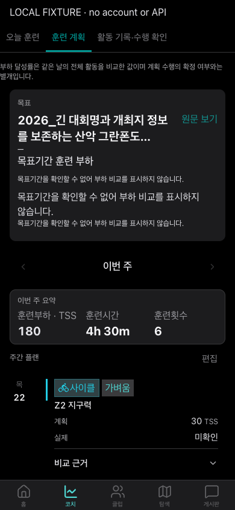

# 시스템 테마와 실시간 화면의 절전 다크

일반 웹은 기존 기본값인 시스템 테마를 유지하며 실행 중 OS 변경을 HTML 속성·폼 색·디자인 토큰에 함께 적용한다. 기존 명시적 light/dark 선택은 보존한다. 이벤트 라이브와 클럽 모임 라이브(임베드 포함)는 절전 다크를 우선한다.

앱 임베드는 브라우저 저장 설정보다 승인된 네이티브 호스트의 테마를 우선한다. host.themeChanged는 승인된 세션에서만 처리하고 현재 표면·인증·선택 상태를 보존한다. 구 앱은 기존 sessionAccepted 테마로 동작하며 새 메시지를 요구하지 않는다. 실행 중 테마 전달에는 함께 작업한 앱 변경이 필요하다.

폰트와 치수 토큰은 변경하지 않았다.

## 검증

- 전체 npm test: Vitest 984개 파일, 10,449개 테스트 및 스크립트 계약 테스트 통과.
- 최종 임베드/테마 관련 변경 후 추가 테스트 90개 통과.
- lint:budget, quality:budget, production build 통과.
- production build는 저장소 CI와 같은 VITE_ORIDER_AI_API_BASE=https://coach.example.run.app 임시 환경값을 사용했다. 실제 서비스 연결 검증이 아니다.
- Chrome 390×844, 합성 계획 화면: 실행 중 light→dark 전환 전후 글자 크기 16px, 화면 높이 844px, 보이는 요소 311개의 위치·크기가 모두 같았다. 측정값은 web-measurements.json에 보관했다.
- 실기기 배터리 차이는 측정하지 않았다. 머지·배포 전 상태다.

## 화면

실제 계정/API 호출 없이 기존 합성 계획 fixture를 사용했다.

| 시스템 라이트 | 시스템 다크 |
| --- | --- |
|  |  |
