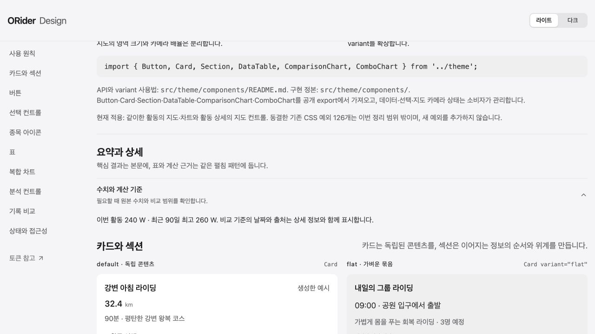

# Activity analysis reading flow

Route: `/ko/activity/:activityId?tab=analysis` (bike, owner; also retain public/missing-data behavior).

- First reading: one activity interpretation and distinct load, NP, IF values before the exploration workspace.
- One power chart: switch between record history and the rolling 90-day reference; match chart dimensions, axis and power color. Each duration is a maximum average over that window, distinct from the whole-ride average.
- Keep power/heart-rate zone tables visible together on desktop. Show secondary calculations and wide evidence tables through the shared native Disclosure.
- Preserve producer values, comparison dates, measurement basis, source activity links, privacy and missing-data semantics.

## Observed verification

- Desktop 1280px and mobile 390px: no horizontal page overflow, including the open wide evidence table.
- Changing comparison basis leaves only its chart mounted. Duration dropdown and keyboard End update the selected value and the exact reference activity link.
- Full Vitest: 871 files / 9,333 tests passed; script contracts passed. Lint and quality budgets passed. `npm run build:dev` passed. The production build's environment preflight requires a locally absent AI API URL; deployment remains governed by CI configuration.
- Delegated owner session: original dev response and live metrics/PDC inspected. Local analysis presentation was replayed through the repository's existing localhost-only preview route because the local overview callable was unavailable. No preview server, captured payload or credential is committed.

The screenshot uses generated catalogue data, light theme, 1280x720. Actual activity screenshots stay local to avoid publishing private ride details. `/design-system-controls.html` exposes the same component for keyboard/touch and theme review.
