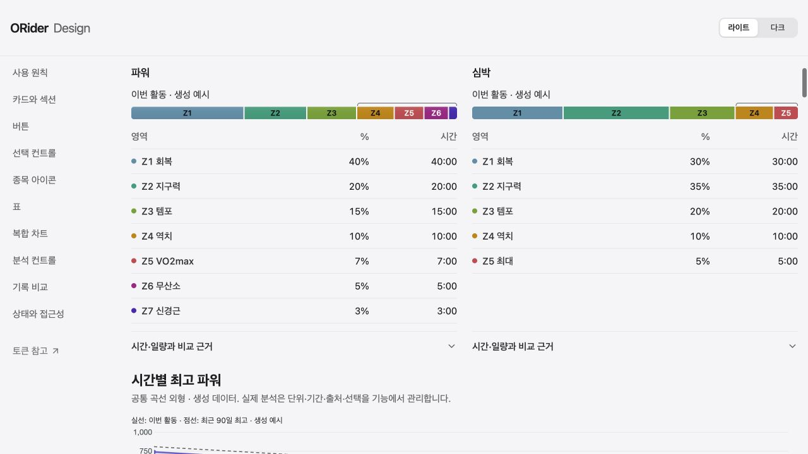
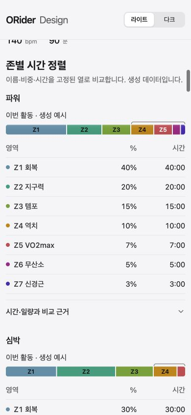

# Activity analysis layout and readability

Scope: activity detail → analysis, 1280×720 and 390×844. Coach goals/actions are unchanged.

- Intro, summary, exploration entry and analysis body share a 68rem reading column.
- Comparison basis and duration belong to one control row above the curve; narrow screens stack them in the same order. Current/reference values share a bounded two-column reading area below the plot.
- Zone distributions use fixed name/share/time columns with every recorded zone retained, including observed zero. Missing percentages are not calculated. Desktop power/heart-rate headings, strips, table headers and disclosure controls align; mobile preserves the same column order in a vertical flow.
- Secondary metric facts use label/value rows. Responsive Stat labels and values share a mobile row with the explanation on a full-width line; desktop retains three metrics across.
- Existing domain calculations, comparison references, accessible exact evidence, estimated/missing states and coach responsibilities are retained.

Synthetic catalogue evidence (no account data): `/design-system-controls.html`, “존별 시간 정렬”, light theme. Shared responsive Stat is demonstrated in the summary section. Browser DOM measurements confirm both desktop zone headings, strips, table starts and disclosure tops have identical y coordinates. Mobile viewport and document width are both 390px. Private activity screenshots and captured response payload are excluded from Git.

