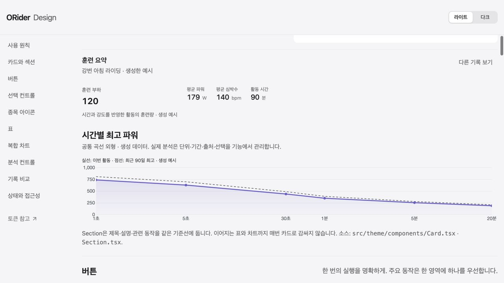
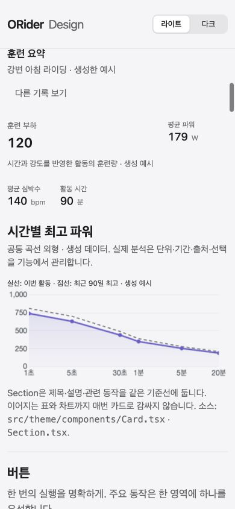
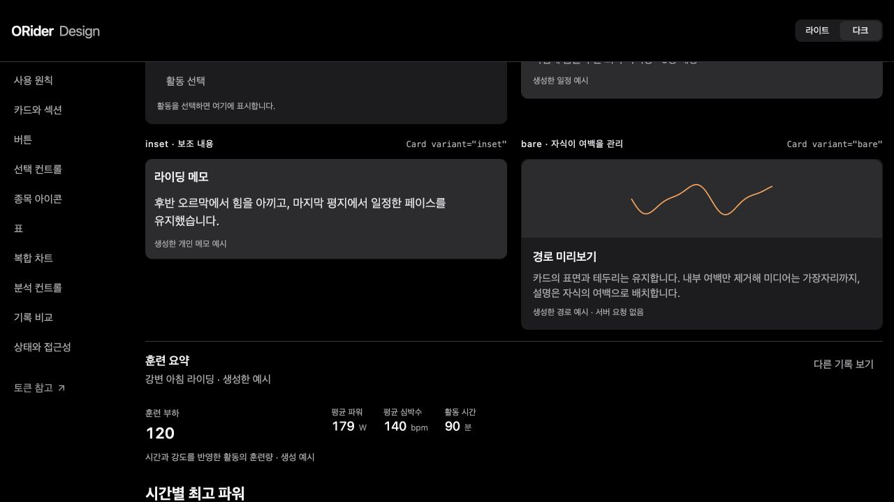

# Activity analysis: interpretation before exploration

Route: `/ko/activity/:activityId?tab=analysis`, bike, owner and public/missing-data fixtures. Check both 390×844 and 1280×720. Catalogue at `/design-system-controls.html` uses synthetic data only.

The first screen explains the recorded activity and the meanings of load, NP and IF. Time-only and heart-rate load estimates retain their own source descriptions. Map and sensor exploration opens on demand; its first map mount occurs with a visible container and the map is retained after that. Overview, other sports and peak-location navigation retain their existing paths.

Zone distributions show recorded percentages/durations in the existing interactive strips, with exact time/work/baseline/delta tables one disclosure away. Desktop places power and heart rate side by side; mobile stacks them. No missing percentage is synthesized.

Duration curves share a quieter surface: smaller marks, a translucent area under the current curve, dashed comparison and horizontal guides. Straight segments, logarithmic time, source links and keyboard selection remain. The shared fill supports native OKLCH colors and safely omits unresolved optional colors. The comparison sentence names the selected duration and measured gap, without interpreting a lower percentage as declining fitness or poor training.

Validation: complete Vitest and script contracts, lint/quality budgets, TypeScript and development build. Delegated owner UI checked against live metrics/PDC and a captured original overview response replayed through the existing localhost-only endpoint. Checked summary, zone detail expansion, comparison selection/source, exploration opening, map size and page overflow. Captured payload/config and account screenshots are excluded from Git.

