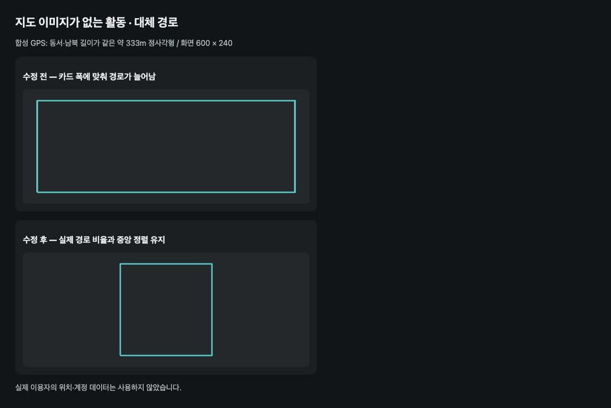

# 경로 대체 썸네일 비율 검증

지도 이미지가 없거나 지도 로딩에 실패한 경우의 경로 비율 회귀를 검증한다.

- 입력: 위도 37도에서 동서·남북 길이를 같게 만든 합성 정사각형 GPS 경로. 실제 이용자의 데이터는 사용하지 않는다.
- 렌더링: 600×240 화면, SVG viewBox 320×160. 수정 전의 독립 축 배율과 수정 후 `buildStaticRoutePath` 출력 및 `xMidYMid meet`를 브라우저에서 비교했다. 아래 이미지는 경로 유틸리티의 비교 렌더이며 실제 앱 화면 캡처는 아니다.
- 결과: 수정 전은 가로로 늘어난 직사각형, 수정 후는 중앙에 정렬한 정사각형이다.
- 자동 검증: `src/utils/staticRoutePath.test.ts`와 `src/components/RouteMap.test.tsx`. 독립 구간, 잘못된 좌표, 직선, 중복 좌표, 날짜 변경선도 포함한다.
- 활동의 작성자 여부, 접근 권한, 지도 이미지 생성 정책은 변경하지 않는다.

