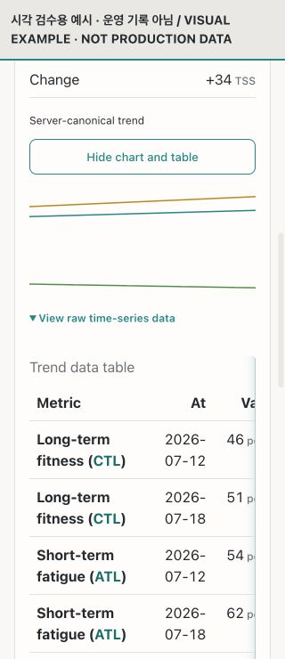

# Web UI review evidence / 웹 UI 검수 증빙

The accumulated Club/Explore and Home/Coach review changes preserve server data and existing feature gates. Production-account screenshots are deliberately kept outside the public repository. This committed screenshot contains only existing renderer test fixtures, with network, submission, and external navigation blocked.

## Mobile answer example

The entire page fits the 320px viewport. Wide data tables retain their own horizontal scroll rather than expanding the page. This example verifies renderer layout only; it does not verify a successful production Coach response.

## Reviewed scope

Home cycling/running, Coach condition/today/plan/goals/analysis/chat error state, nested controls and expanded evidence, KO/EN, desktop and 320px mobile. Independent visual review rated the supplied final observed states 9.5/10. This score does not cover unobserved or blocked states.

Operating-account writes (goal/plan changes, training completion, invitations, publishing, and AI submission) were not executed. Successful production chat remained blocked by a data-load error. Some deeper analysis controls depend on release flags or eligible source data. Separate fixture checks do not replace those runtime checks.

## 한국어

운영 계정 화면은 로컬 검수 증빙에만 보관했습니다. 위 이미지는 기존 테스트 예시를 실제 답변 렌더러에 표시한 것이며 운영 기록이 아닙니다. 성공한 실제 대화나 아직 열리지 않은 기능까지 검수 완료로 간주하지 않습니다.
