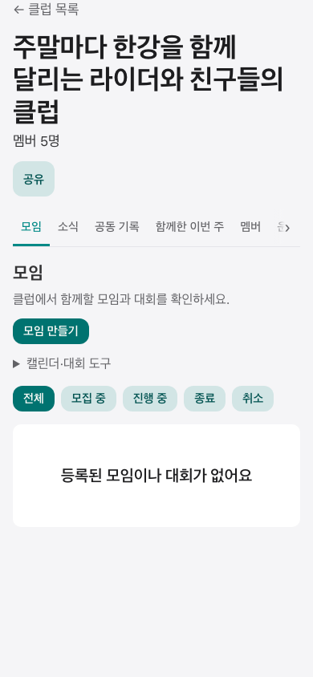
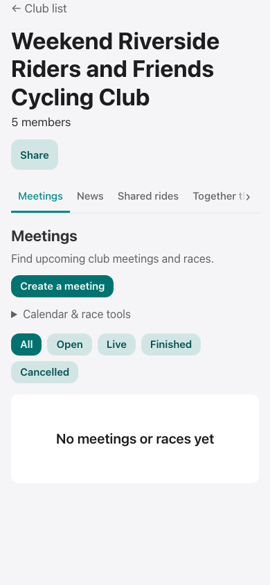
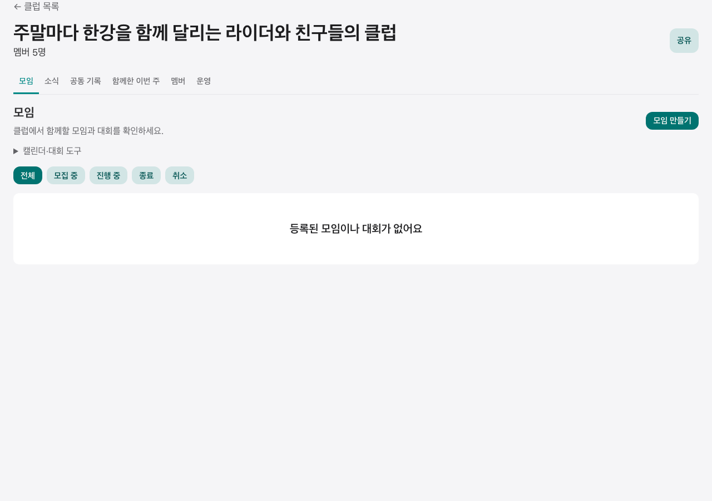
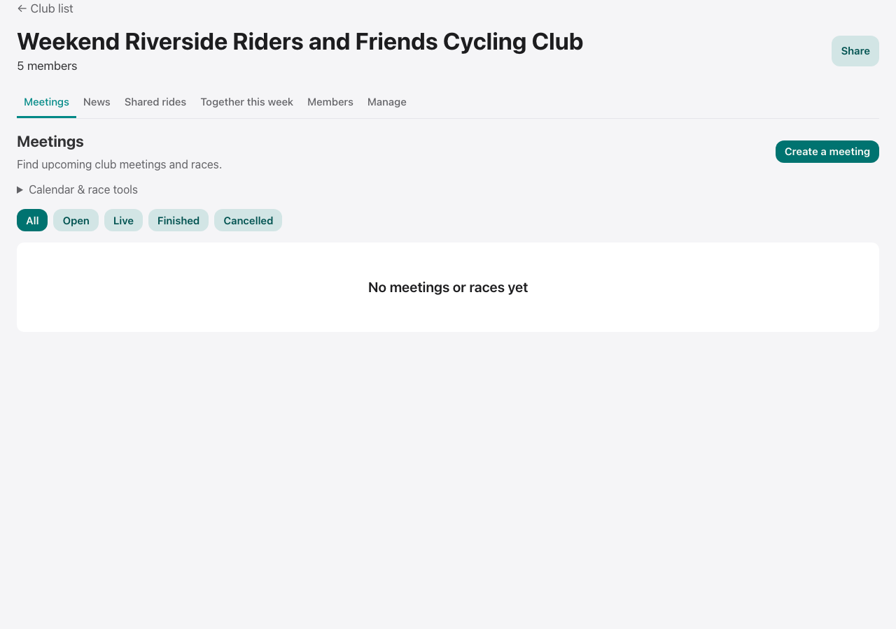

# 클럽 모임 진입 기획 리뷰

사용자 문제: 모임 생성 폼은 충분하지만 `클럽 → 이벤트 → 모임 → 생성`의 분류와 이동이 어렵다. 추가 바로가기보다 하나의 체계와 직관이 필요하다.

## 확정된 정보 체계

`내 클럽에서 클럽 선택 → 클럽 기본 모임 목록 → 모임 만들기 → 기존 폼`

- 생성 진입점은 모임 목록의 버튼 한 곳이다. 클럽 카드와 공통 헤더에는 생성 버튼을 추가하지 않았다.
- 가입 회원은 클럽 기본 주소에서 모임 목록을 본다. 소식은 두 번째 탭(`/news`)이다.
- 비회원·비로그인은 기존 소개/가입 화면을 이용한다. 회원 확인 중에는 기다리고, 실패는 재시도로 분리한다.
- 대회 생성·캘린더 구독은 목록의 보조 도구이며, 빈 목록에서도 상단의 동일한 생성 버튼을 쓴다.
- 옛 `/events` 주소는 query/hash/state를 유지해 기본 주소로 replace한다.
- 생성 폼 `MeetingForm.tsx`와 저장 계약은 변경하지 않았다. 돌아가기·닫기는 모임 기본 주소로 통일했다.

## 독립 기획 휴리스틱 재리뷰

동일한 독립 리뷰 담당자가 코드 및 아래 화면 4장을 직접 검토했다. 실제 사용자 조사·전환율·실기기 평점은 아니다.

| 항목 | 배점 | 기존 | 최종 | 근거 |
| --- | ---: | ---: | ---: | --- |
| 발견성 | 2 | 0.8 | 2.0 | 클럽 기본 화면이 모임 목록, 생성 CTA 한 곳 |
| 진입 단계 | 2 | 0.9 | 2.0 | 분류 선택 없이 클럽 선택 후 생성까지 2클릭 |
| 용어·위계 | 2 | 1.0 | 1.9 | 모임/소식 분리, 대회 도구 보조화 |
| 상태·권한 | 1.5 | 1.3 | 1.4 | 일반 회원/운영자, 방문자, 확인 중/실패 분리 |
| 모바일·임베드 | 1.5 | 1.1 | 1.3 | 긴 이름 ko/en 첫 화면 CTA, 기존 named app/bridge 유지 |
| 회귀 안전 | 1 | 0.8 | 0.9 | 실제 폼 도달, 기존 주소/탭/로케일/복귀 검증 |
| 합계 | **10** | **5.9** | **9.5** | 기획상 필수 수정사항 없음 |

초기에는 단계를 '1클릭 직행'으로 평가했으나, 사용자의 '두 동선이 아니라 체계와 직관' 교정에 따라 '불필요한 분류 없는 2클릭'으로 기준을 명시적으로 수정했다. 나머지 배점은 유지했다.

남은 검증 한계: 실제 사용자 과업 성공률과 iPhone/Android 실기기 UX는 측정하지 않았다. 자동화 결과와 구분한다.

브라우저 회귀 테스트 fixture/config/spec은 리뷰 입력 한도를 지키기 위해 동반 PR로 분리한다. 아래 브라우저 결과와 이미지는 분리 전 동일 구현을 실제 실행해 얻었으며, 동반 PR의 머지까지 완료해야 작업 완료로 판정한다.

## 재현 증거

- `npx playwright test --config e2e/club-meeting-entry.config.ts`: 모바일 390×844 / 데스크톱 1280×900, ko/en 4개 시나리오. 실제 ClubHomePage/GroupEventsPage/ClubMeetingPage/MeetingForm을 렌더하고 데이터 I/O만 가상 데이터로 제공한다. 카드 선택→기본 목록→유일 생성 버튼→실제 폼→닫기 복귀, CTA의 viewport 포함 및 가로 넘침을 검사한다.
- `src/embedded/EmbeddedBootstrapRoot.clubFlow.test.tsx`: 실제 bootstrap와 실제 페이지/폼, 일반 Firebase 싱글턴이 없는 상태에서 named app으로 목록→생성→닫기→소식→뒤로가기. 브리지 생성 1회, 이동 중 dispose 없음, host theme 수신, native/external handoff 없음, callable이 named functions 사용.
- `ClubHomePage.test.tsx`: 일반 회원/운영자·방문자·비회원·확인 중/실패.
- `ClubEventsRedirect.test.tsx`: 웹/임베드 ko/en 옛 링크의 필터·앵커 보존.
- 기존 모임 생성/수정/저장·클럽 소식·회원 권한 테스트를 함께 실행한다.

모든 이미지와 브라우저 fixture는 가상 클럽이다. 실제 사용자 데이터/운영 쓰기를 사용하지 않았다.

### 모바일

### 데스크톱

