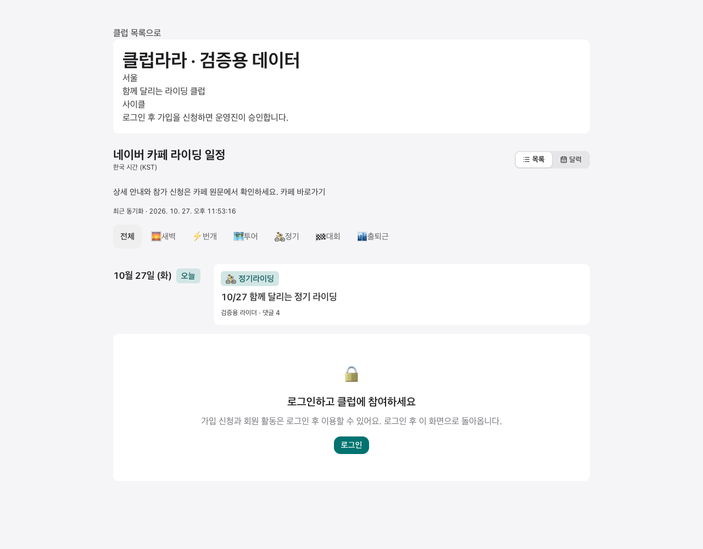
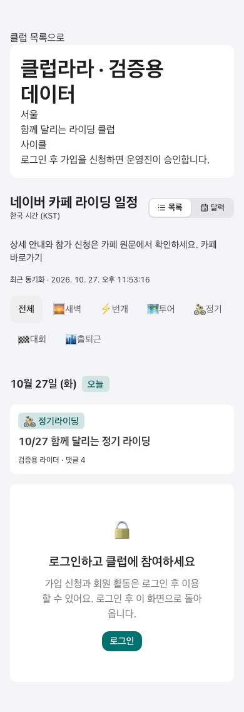

# Club schedule request validation

- Route/component: anonymous `/ko/club/club-lara` public preview.
- Locale/viewports: Korean, desktop 1280x1000 and mobile 390x844.
- Data: synthetic public club and one ride; AuthContext mocked as a visitor.
- Browser: isolated headless Chrome against local Vite, using the actual preview and schedule components.
- Result: introduction and schedule rendered from one combined HTTP request; no page errors. These images verify layout and request count, not production response times.

