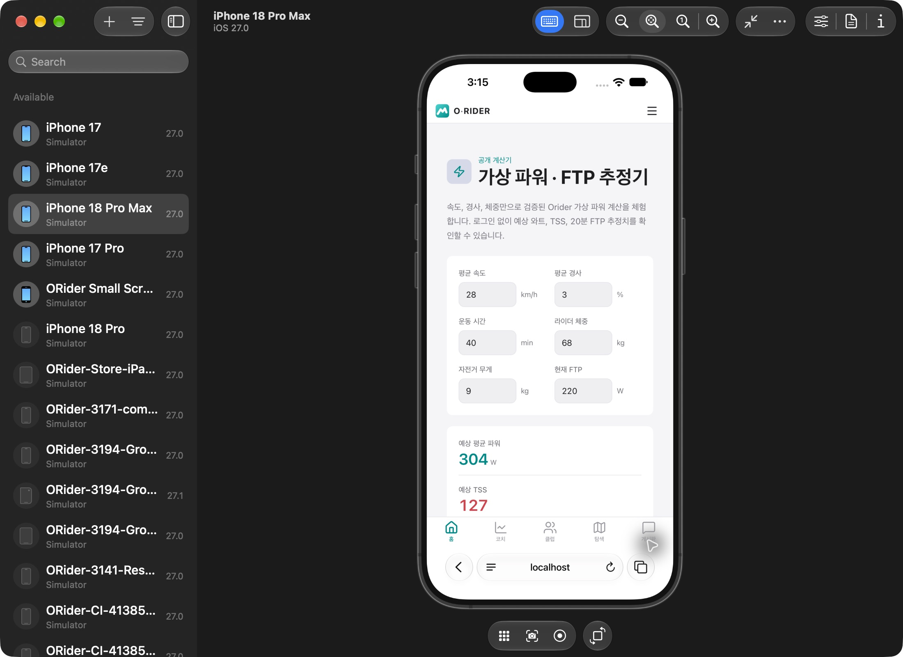
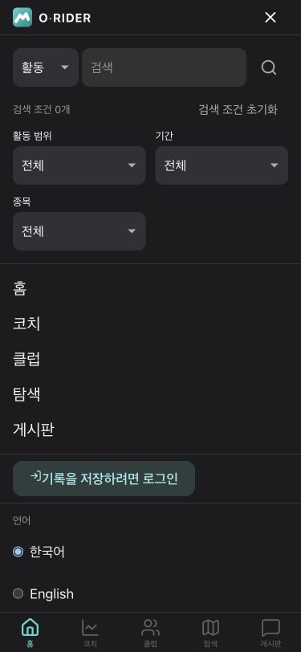
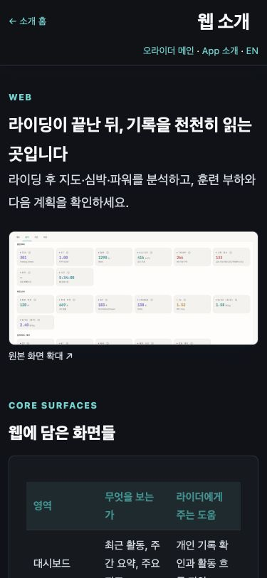
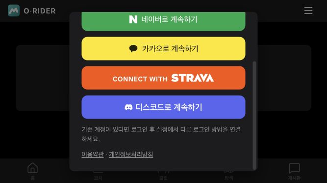
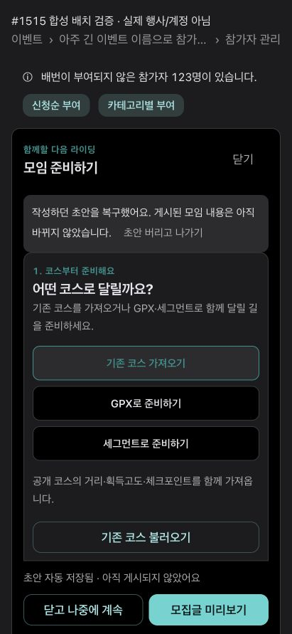
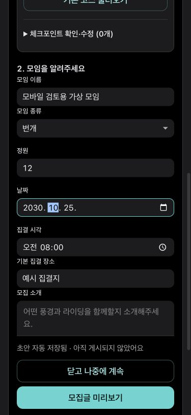

# Mobile release audit #1515 implementation

Issue: https://github.com/miranae/orider-web/issues/1515

2026-11-05 KST. This change implements the presentation fixes below. It does not establish completion of every acceptance state in the consolidated issue. The original iPhone and Galaxy observations remain the audit source.

| Item | Implementation / disposition |
| --- | --- |
| 1 | Mobile navigation retains focus on its trigger instead of opening the search keyboard. Desktop search autofocus and Escape/Tab behavior remain covered. |
| 2 | Shared login modal height follows `dvh` with a scrollable interior. At 667×375, scrolling exposes Discord and legal links and scrolling back exposes Close. Physical iPhone touch/rotation remains to verify. |
| 3 | One decision status heading replaces repeated headings/badge. No unavailable change instruction is shown. “Prescription not ready” becomes “new recommendation not ready,” distinguishing it from a scheduled rest day. No prescribed workouts or zero values are fabricated. |
| 4 | Remove the raw normal/taper/source tuple from the card; shorten device delivery explanations. Keep consent, health gates, expiry and target-versus-actual contracts. |
| 5 | Avoid a second plan link when the scheduled card already links to the plan. Quick-workout copy explains separation from plan sessions without repeating estimated TSS examples. |
| 6 | Operational repair: the exact six identified QA events now have `info.visibility=PRIVATE`. No name-based client filter and no deletion. See the operation record below. |
| 7 | No speculative footer-spacing patch. Prior full-bottom iPhone evidence excluded this as a confirmed overlap defect. General-login/small-screen combinations remain verification work. |
| 8 | Calculator changes from two fixed-minimum columns to a single mobile column; inputs shrink within fields, with one field per row below 384px. Changing speed from 28 to 20 updates estimated power from 304 to 185 W. |
| 9 | **Not activated.** Live runtime `publicActivityDetailEnabled=false`; production `getActivityPublicDetail` is ACTIVE (updated 2026-11-04). The existing rollout document explicitly requires two-account/media/map/privacy validation before enabling. No ACL broadening or owner-document fallback for other users. Follow `public-activity-detail-rollout.md`, WEB #1344 / BE #3373. |
| 10 | Long segment names wrap and align left inside their button instead of being centered/truncated at both ends. |
| 11 | App/web introduction headers use two rows on narrow screens and shorter Korean titles. |
| 12 | Screenshot examples link to the original-size asset with an explicit enlargement hint. This adds readable original access; it does not claim new mobile-specific example images. |
| 13 | App/web pages keep one feature table and direct destinations; remove repeated role/aspirational feature lists and development-history prose. The introduction home retains its separate sport/community workflow. |
| 14 | Keep comparison results and their meaning visible; move calculation/source explanations into a disclosure. |
| 15 | Empty rest-day loads use one compact sentence instead of a two-row metric table. Future remains “upcoming”; unknown and estimated actual loads retain their original rendering and evidence. |
| 16 | Source dates wrap as one unit rather than isolating the day. |
| 17 | Missing 20-minute interval explanation is a separate paragraph after the power value. |
| 18 | Guest challenges explain purpose and example distances, and provide login. Examples are labelled; no personal progress is shown. |
| 19 | Keep D+ countdown and the explanatory expired-period message; remove the extra expired badge. Goal status and date are unchanged. |
| 20 | Breadcrumb fixed labels do not shrink; the event name truncates. Bib notice text and buttons wrap into separate mobile rows. |
| 21 | One bottom draft/action area replaces the two repeated action groups. Draft versus published status and preview/save flow remain. |
| 22 | Settings, gear, annual records and friends share a login action using the existing modal flow; the current destination remains mounted. |
| 23 | Public policy document no longer calls the authenticated consent endpoint. Its published v4 text matches backend `origin/main` policy; personal consent remains an authenticated settings operation. Update the public snapshot when that policy version changes. |
| 24 | Bound event edit/register/results reads to 15 seconds each and discard stale error updates. An integration test proves a hanging results read becomes an error with retry. **The original production incident root and normal-login/OPEN-event reproduction remain unverified.** Optional course/profile reads may fail independently without hiding the event. |
| 25 | Replace source/sample/TTL implementation vocabulary in Korean connection settings with data-source, health-data and retention wording; retain 365-day/permanent retention and overdue-deletion conditions. |

## Verification evidence

- Node 22: full Vitest run, 986 suites / 10,453 tests passed; repository script contracts passed. Lint and quality budgets passed. Production build passed with the already deployed public AI API URL supplied only to the command (the shared `.env` lacks it).
- An iPhone 18 Pro Max / iOS 27.0 Safari screenshot proves calculator inputs are visible above results on the local implementation. Device Hub subsequently returned intermittent window/AX errors, so the remaining screenshots are **desktop browser responsive checks**, not additional Safari or Galaxy evidence.
- Responsive checks: 375×812 and 411×891; login 667×375. Menu focus stays on Close, calculator input changes update results, guest login opens the modal, modal wheel-scroll exposes all providers/legal links and returns to Close, public policy renders without sign-in, introduction title and original-image link remain visible.
- The two `synthetic-*` screenshots use the actual MeetingForm with fake local data plus a small reproduction of the participant header markup using the production CSS. They establish layout only, not event authorization, host APIs, production data or the outer app/WebView navigation shell.
- Source audit screenshots containing private ride details remain local and are not committed.

Other public screenshots are under `docs/evidence/1515/`.

## Exact operational change for item 6

Project `miranae-orider-g1`, 2026-11-05 15:20 KST. All six documents initially had no `info.visibility`. Updated only that nested field to `PRIVATE`, using each document's read update-time precondition in one atomic batch. Read back every document and compared all remaining fields to the in-memory before image; every other field, including status, matched. The minimal rollback list records that visibility was originally absent and is kept in the local audit artifact directory. No unrelated event was selected.

| Event ID | Identified QA content | Status preserved |
| --- | --- | --- |
| `9ugWiHzFZRx3sWnD7xXw` | 테스트 라이딩 2026-09-22 | FINISHED |
| `ICbuJubo5wOmpGuEgiKz` | 테스트 라이딩 2026-09-22 | FINISHED |
| `KCuz82uXUAzhfe81sYjS` | 테스트 라이딩 2026-09-22 | FINISHED |
| `WjjBWHaDtcrzhx28ZB7j` | 테스트 라이딩 2026-09-22 | FINISHED |
| `zxjM8qj1cbfZWhaIKki7` | 테스트 라이딩 2026-09-22 | FINISHED |
| `FBbUXxxHyOCJBBsPfRYi` | ORider QA M4 20261024 라이딩 2026-11-03 | LIVE |

This is public-discovery cleanup, not a false assertion that the QA ride has finished. Existing private-event discovery exclusion is covered by `EventsPage.publicFilter.test.ts`. Both production login states still need a fresh list check; do not equate a document readback with that UI evidence.

## Remaining release verification

Keep #1515 open until the public-detail rollout decision, original event-loading reproduction, production post-deploy login/guest checks, iPhone touch/rotation checks and Galaxy real-device recheck are recorded. A dev merge is not a production deployment. No release tag or hosting deployment is included here.
