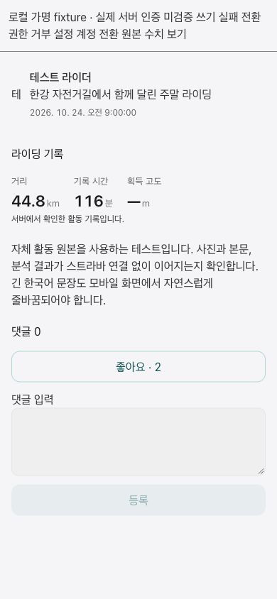
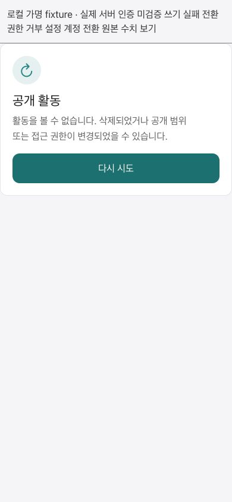

# Public activity detail: first vertical slice

Parent: miranae/orider-g1-app#2882; WEB #1344; BE miranae/orider-g1-web#3373.

## Scope and rollout

`publicActivityDetailEnabled` defaults to **false**. With the flag absent/false, `/[lang]/activity/[id]` retains the existing full ActivityPage and does not call the new API. Only an explicit runtime boolean true (or local `VITE_PUBLIC_ACTIVITY_DETAIL_ENABLED=true`) enables public preflight. Do not enable production as part of this PR: the new callable and field contract must be deployed and verified first.

When enabled, a public DTO determines ownership before any owner analysis hook mounts. Owners retain ActivityPage. If the new API is unavailable, an authenticated viewer can use an owner-only Firestore query (document ID + current user ID) to prove ownership; only that verified owner can fall back. Other users fail closed. Account/activity changes discard late responses.

The standalone embedded route `/[lang]/embed/activity/[id]/public` reuses the same UI and isolated Firebase handoff. Native app integration remains deferred. The existing analysis embed also retries the canonical overview on host retry and does not show a contradictory unavailable message when canonical evidence has loaded.

## Contract and semantics

- `getActivityPublicDetail`, `setActivityKudos`, `postActivityComment`: asia-northeast3; stage uses its configured callable base. Use the injected Firebase app, never singleton auth for embedded calls.
- No activity streams, private metrics, profile threshold values, or thumbnail-generation writes in the new public surface.
- `effectiveFacts.status=canonical` provides display metrics. Explicit canonical null remains missing (`—`). Other states show the recorded summary with a source note; this does not declare analysis ready.
- `summary.distance` is **metres** (divide by 1000 for km). `effectiveFacts.metrics.distanceKm` is km. Raw `ridingTimeMillis` is milliseconds; effective `durationSec` is seconds. Display time is recorded duration, not relabelled moving time.
- Optional `mapPreview.imageUrl/encodedPolyline` supplies the server-admitted bounded public map preview. RouteMap renders it without loading raw GPS or writing a thumbnail.
- Photos and comments are bounded previews, not complete lists. `uploadedPhotosTruncated` explicitly labels photo truncation; comment count larger than loaded comments labels the preview.
- Comment limit is 500 characters. The same draft retains `clientRequestId` across failed/uncertain retries; successful submission clears it. Reactions serialize concurrent taps and re-read the permission-checked projection. A failed permission readback removes displayed data. Comment input survives mutation failure.
- Anonymous visitors can read permitted public detail; reaction controls require a signed-in, nonanonymous user. Access-denied/not-found is distinguished from transient network failure.

## Verification

- Component and service tests cover source units, canonical missing values, owner/public route separation, gate disabled behavior, owner-only fallback, account change races, retry idempotency, reaction serialization, comment preservation, and permission readback.
- Local browser evidence uses synthetic public DTOs and the actual surface component. It proves rendering and interaction behavior, not production authorization or native app delivery.
- Backend authorization/serialization tests are tracked separately in BE #3373. This PR does not deploy or merge either repository.

## Remaining work before enabling by default

1. Full comments pagination, editing/deletion/moderation and profile navigation parity with existing ActivityPage; bounded previews must not replace the complete experience by default.
2. Real two-account feed→public detail→reaction→owner analysis validation against the deployed candidate API, including private/friends/blocks/deletion.
3. Map privacy/preview coverage and photo permissions with actual own-source activities; cold/warm latency measurement.
4. Runtime rollout/rollback evidence. Keep the gate off until the richer existing public experience is preserved and acceptance criteria are satisfied.

## Synthetic browser evidence

390 px Korean mobile viewport, Strava-unconnected own-source-shaped DTO fixture:

Independently checked recorded 25,000 m → 25 km / 7,200,000 ms → 120 min, canonical 44.8 km / 7,000 s → 116 min and null elevation → —; failed comment retains draft, retry posts once and reads back; account switch removes prior content. Map rendering itself was not exercised in this fixture pass. Existing native feed photo projection production remains BE #3373 follow-up; this detail UI does not add per-card fetching.
