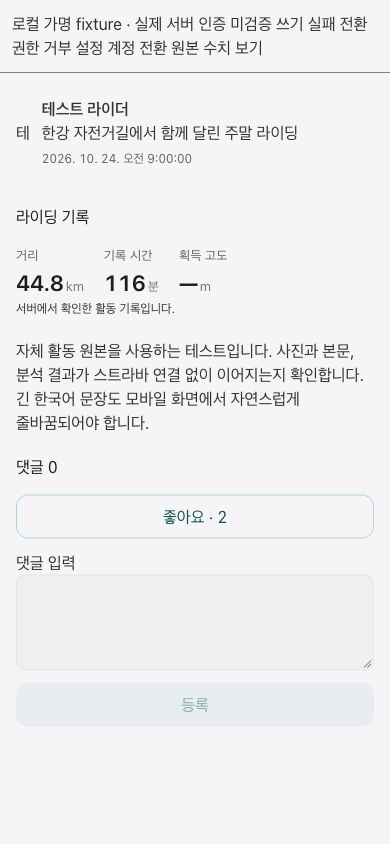
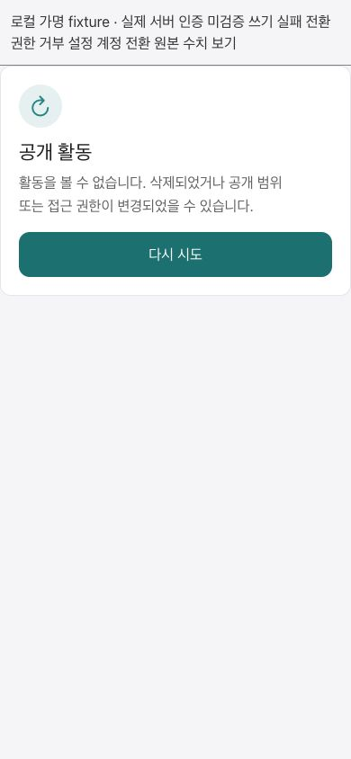
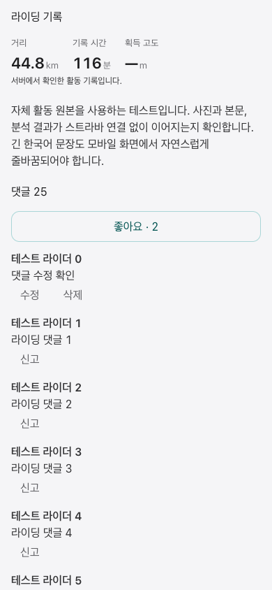
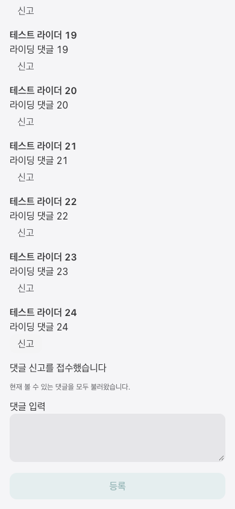

# Public activity detail: rollout and acceptance

Parent: miranae/orider-g1-app#2882; WEB #1344; BE miranae/orider-g1-web#3373.

## Scope and rollout

`publicActivityDetailEnabled` defaults to **false**. With the flag absent/false, `/[lang]/activity/[id]` retains the existing full ActivityPage without public preflight. Its owner-only transient-read recovery can still call the public API; this is not a guest/non-owner fallback. Only an explicit runtime boolean true (or local `VITE_PUBLIC_ACTIVITY_DETAIL_ENABLED=true`) enables public preflight. Keep production disabled until the deployed callable contracts and the real-account acceptance checks below are verified. A disabled gate does not resolve guest/non-owner permission failures on the legacy route.

When enabled, a public DTO determines ownership before any owner analysis hook mounts. Owners retain ActivityPage. On a transient API failure (not an access-denied/not-found/failed-precondition or unauthenticated response), an authenticated nonanonymous viewer can use a server-confirmed owner-only Firestore query (document ID + current user ID) to prove ownership; only that verified owner can fall back. Other users fail closed. Account/activity changes discard late responses.

`PublicActivitySurface` now renders the shared `ActivityPage` through its `publicAccess` adapter, rather than a separate reduced detail layout. Public mode uses the server-authorized detail/metrics DTO and public streams; it does not mount the owner activity/metrics reads. Shared presentation is not evidence that owner-only data is accessible.

The standalone embedded route `/[lang]/embed/activity/[id]/public` reuses the same UI and isolated Firebase handoff. Native app integration remains deferred. The existing analysis embed also retries the canonical overview on host retry and does not show a contradictory unavailable message when canonical evidence has loaded.

## Contract and semantics

- `getActivityPublicDetail`, `getActivityPublicComments`, `getActivityPublicPhotos`, `getActivityPublicStreams`, and the existing social mutations use asia-northeast3; stage uses its configured callable base. Use the injected Firebase app and App Check readiness, never singleton auth for embedded calls.
- Public mode can request streams through `getActivityPublicStreams` for the shared detail/analysis presentation. It must not fall back to direct owner-only Firestore or private stream reads. The public DTO, metrics and stream responses remain separate server-authorized contracts; do not describe this surface as stream-free.
- Backend `assertActivityPublicAccess` admits `everyone`, mutual `friends`, or an active viewer-to-owner `followers` subscription, while other visibility values require ownership. It also checks activity deletion, owner deletion/merge fences, both block directions, and the signed-in viewer's hidden-activity record. Each public read/mutation must retain its applicable permission checks; successful initial detail loading is not a lasting access grant.
- `effectiveFacts.status=canonical` provides display metrics. Explicit canonical null remains missing (`—`). Other states show the recorded summary with a source note; this does not declare analysis ready.
- `summary.distance` is **metres** (divide by 1000 for km). `effectiveFacts.metrics.distanceKm` is km. Raw `ridingTimeMillis` is milliseconds; effective `durationSec` is seconds. Display time is recorded duration, not relabelled moving time.
- Public maps are independently loaded through `getActivityPublicMaps` and bound to the current account/client and fresh privacy/content revision. `ActivityPublicAccess` supplies the admitted `imageUrl/encodedPolyline` to the shared page and hides stale content during revalidation. Public streams are a separate read, so actual map privacy and exported/analysis data must be checked together; a visible preview alone does not prove privacy acceptance.
- Photos remain bounded previews. `uploadedPhotosTruncated` explicitly labels photo truncation; `totalPhotoCountExact=false` is a scan lower bound and feed cards say “more photos”, not an invented exact remainder. Comments start from the detail preview and continue through server-authorized opaque cursors (20 scanned rows per page); an empty visible page can still have another cursor.
- Comment limit is 500 characters. The same draft retains `clientRequestId` across failed/uncertain retries; successful submission clears it. Reactions serialize concurrent taps and re-read the permission-checked projection. A failed permission readback removes displayed data. Comment input survives mutation failure.
- Anonymous visitors can read permitted public detail; reaction controls require a signed-in, nonanonymous user. Access-denied/not-found is distinguished from transient network failure.

## Verification

- Component and service tests cover source units, canonical missing values, owner/public route separation, gate disabled behavior, owner-only fallback, account change races, retry idempotency, reaction serialization, comment preservation, and permission readback.
- Local browser evidence uses synthetic public DTOs and the actual surface component. It proves rendering and interaction behavior, not production authorization or native app delivery.
- Backend authorization/serialization tests are tracked separately in BE #3373. Function ACTIVE status and READY indexes prove deployment prerequisites, not successful App Check, account ACLs, media permissions or device acceptance. Deployment evidence and outstanding mobile checks are tracked in WEB #1515.

## Remaining work before enabling by default

1. Real-account gallery and route privacy validation. The new explicit native gallery request now returns up to twenty admitted active photos; provider galleries remain unchanged behind the disabled rollout gate. Owner moderation remains on the existing owner ActivityPage; public viewers can edit/delete their own comments and report other comments.
2. Guest and real two-account feed→public detail→reaction/comment readback→owner analysis validation against the deployed candidate API. Include everyone/friends/followers/private, subscription changes, both block directions, hidden activities, deletion/fences and account switches; access loss must remove previously displayed content. Use approved QA activities for mutations.
3. Map privacy enabled/disabled, preview/stream/export consistency and native/provider photo permissions with actual own-source activities. Exercise background→foreground revalidation, measure cold/warm latency, and capture Samsung Internet and Chrome on the Galaxy plus iPhone Safari touch/rotation. Responsive desktop captures do not replace device evidence.
4. Runtime rollout/rollback evidence. Keep the gate off until the richer existing public experience is preserved and acceptance criteria are satisfied.

After acceptance, set the production Environment variable `VITE_PUBLIC_ACTIVITY_DETAIL_ENABLED=true` and use the existing `v*` tag Hosting workflow (`scripts/release-tag.sh`); the workflow already forwards it to `write-runtime-config.mjs`. Verify the live runtime boolean, deployed bundle and device journeys. Roll back by setting the variable to false and deploying through the same workflow, or restoring the previous Hosting release. Reload pages when verifying either direction because runtime config is read at startup.

## Historical synthetic browser evidence (first slice)

These earlier fixture captures describe the first slice, not acceptance of the current shared-page/streams implementation.

390 px Korean mobile viewport, Strava-unconnected own-source-shaped DTO fixture:

Independently checked recorded 25,000 m → 25 km / 7,200,000 ms → 120 min, canonical 44.8 km / 7,000 s → 116 min and null elevation → —; failed comment retains draft, retry posts once and reads back; account switch removes prior content. Map rendering itself was not exercised in this fixture pass. Existing native feed photo projection production remains BE #3373 follow-up; this detail UI does not add per-card fetching.

## Continuation: comments and native authored memo

- `getActivityPublicPhotos({activityId})` expands the native preview only after an explicit request (up to twenty admitted photos, with truncation labelled). It rechecks permissions and clears the parent detail when access is revoked.
- `getActivityPublicComments({activityId,cursor?})` returns `{comments,nextCursor,scannedCount}`; stable server cursors preserve timestamp precision. Duplicate IDs are replaced, stale/deleted cursors offer a restart without discarding the current page, and permission loss removes the detail.
- Comment editing, explicit delete confirmation, reporting, and author profile links use existing server mutations. No unbounded Firestore listener or per-author profile reads were added.
- `setActivityNativeMemo({activityId,memo,expectedMemoRevision})` is exposed only for the owner’s native activity when the rollout flag is enabled. It loads the server revision first; conflicts retain the draft and require an explicit latest-text reload. The authored memo is distinct from title and generated summary.
- Existing native feed projections are consumed through the original revision binding, with no per-card request. Backend producer changes are in miranae/orider-g1-web#3377.
- Production build was verified with the real `aiApiBase` read from the deployed public runtime-config (`https://orider-ai-api-h5zqzw3n4a-du.a.run.app`) as a command-scoped env value. No shared .env or runtime config was mutated.

390 px synthetic browser continuation: 25 comments across two pages; edit, confirmed delete, report and author-profile link all verified with zero page errors. This is UI integration evidence, not deployed authorization proof.

Continuation verification (2026-10-26 KST): final related 45 tests passed; the owner ActivityPage/feed regression selection passed 124 tests. Production build with the verified deployed AI API URL, lint:budget, and quality:budget passed. Full suite under Node 25: 9,318 passed / one existing date-only parsing test failed after KST Monday midnight (`AthleteActivityChart.test.tsx`); the root R6 branch carries that UTC/local test correction. No unrelated test was changed here. Browser checks used local fixture transport; production and Stage were not mutated.
