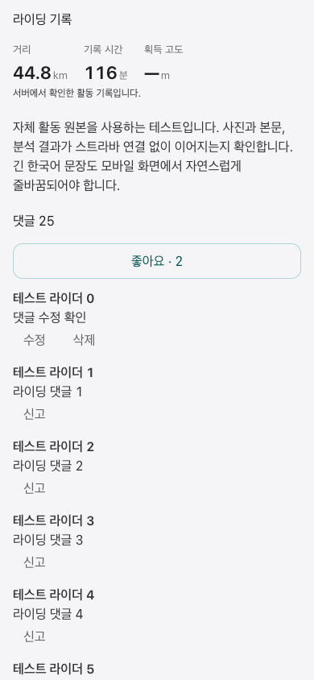
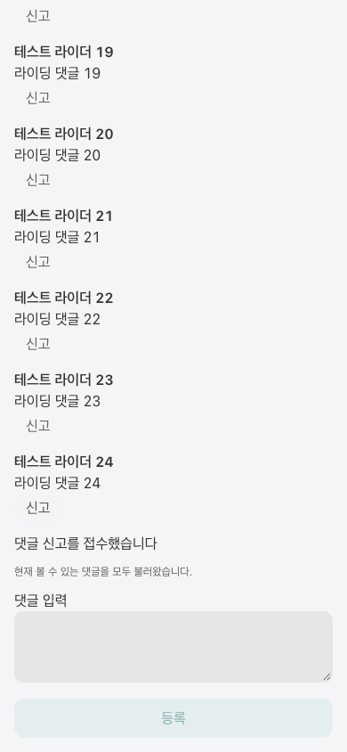

# Public activity detail: first vertical slice

Parent: miranae/orider-g1-app#2882; WEB #1344; BE miranae/orider-g1-web#3373.

## Scope and rollout

`publicActivityDetailEnabled` defaults to **false**. With the flag absent/false, `/[lang]/activity/[id]` retains the existing full ActivityPage and does not call the new API. Only an explicit runtime boolean true (or local `VITE_PUBLIC_ACTIVITY_DETAIL_ENABLED=true`) enables public preflight. Do not enable production as part of this PR: the new callable and field contract must be deployed and verified first.

When enabled, a public DTO determines ownership before any owner analysis hook mounts. Owners retain ActivityPage. If the new API is unavailable, an authenticated viewer can use an owner-only Firestore query (document ID + current user ID) to prove ownership; only that verified owner can fall back. Other users fail closed. Account/activity changes discard late responses.

The standalone embedded route `/[lang]/embed/activity/[id]/public` reuses the same UI and isolated Firebase handoff. Native app integration remains deferred. The existing analysis embed also retries the canonical overview on host retry and does not show a contradictory unavailable message when canonical evidence has loaded.

## Contract and semantics

- `getActivityPublicDetail`, `setActivityKudos`, `postActivityComment`: asia-northeast3; stage uses its configured callable base. Use the injected Firebase app, never singleton auth for embedded calls.
- No activity streams, private metrics, profile threshold values, or thumbnail-generation writes in the new public surface.
- `effectiveFacts.status=canonical` provides display metrics. Explicit canonical null remains missing (`—`). Other states show the recorded summary with a source note; this does not declare analysis ready.
- `summary.distance` is **metres** (divide by 1000 for km). `effectiveFacts.metrics.distanceKm` is km. Raw `ridingTimeMillis` is milliseconds; effective `durationSec` is seconds. Display time is recorded duration, not relabelled moving time.
- Optional `mapPreview.imageUrl/encodedPolyline` supplies the server-admitted bounded public map preview. RouteMap renders it without loading raw GPS or writing a thumbnail.
- Photos remain bounded previews. `uploadedPhotosTruncated` explicitly labels photo truncation; `totalPhotoCountExact=false` is a scan lower bound and feed cards say “more photos”, not an invented exact remainder. Comments start from the detail preview and continue through server-authorized opaque cursors (20 scanned rows per page); an empty visible page can still have another cursor.
- Comment limit is 500 characters. The same draft retains `clientRequestId` across failed/uncertain retries; successful submission clears it. Reactions serialize concurrent taps and re-read the permission-checked projection. A failed permission readback removes displayed data. Comment input survives mutation failure.
- Anonymous visitors can read permitted public detail; reaction controls require a signed-in, nonanonymous user. Access-denied/not-found is distinguished from transient network failure.

## Verification

- Component and service tests cover source units, canonical missing values, owner/public route separation, gate disabled behavior, owner-only fallback, account change races, retry idempotency, reaction serialization, comment preservation, and permission readback.
- Local browser evidence uses synthetic public DTOs and the actual surface component. It proves rendering and interaction behavior, not production authorization or native app delivery.
- Backend authorization/serialization tests are tracked separately in BE #3373. This PR does not deploy or merge either repository.

## Remaining work before enabling by default

1. Real-account gallery and route privacy validation. The new explicit native gallery request now returns up to twenty admitted active photos; provider galleries remain unchanged behind the disabled rollout gate. Owner moderation remains on the existing owner ActivityPage; public viewers can edit/delete their own comments and report other comments.
2. Real two-account feed→public detail→reaction→owner analysis validation against the deployed candidate API, including private/friends/blocks/deletion.
3. Map privacy/preview coverage and photo permissions with actual own-source activities; cold/warm latency measurement.
4. Runtime rollout/rollback evidence. Keep the gate off until the richer existing public experience is preserved and acceptance criteria are satisfied.

## Synthetic browser evidence

390 px Korean mobile viewport, Strava-unconnected own-source-shaped DTO fixture:

Independently checked recorded 25,000 m → 25 km / 7,200,000 ms → 120 min, canonical 44.8 km / 7,000 s → 116 min and null elevation → —; failed comment retains draft, retry posts once and reads back; account switch removes prior content. Map rendering itself was not exercised in this fixture pass. Existing native feed photo projection production remains BE #3373 follow-up; this detail UI does not add per-card fetching.

## Continuation: comments and native authored memo

- `getActivityPublicPhotos({activityId})` expands the native preview only after an explicit request (up to twenty admitted photos, with truncation labelled). It rechecks permissions and clears the parent detail when access is revoked.
- `getActivityPublicComments({activityId,cursor?})` returns `{comments,nextCursor,scannedCount}`; stable server cursors preserve timestamp precision. Duplicate IDs are replaced, stale/deleted cursors offer a restart without discarding the current page, and permission loss removes the detail.
- Comment editing, explicit delete confirmation, reporting, and author profile links use existing server mutations. No unbounded Firestore listener or per-author profile reads were added.
- `setActivityNativeMemo({activityId,memo,expectedMemoRevision})` is exposed only for the owner’s native activity when the rollout flag is enabled. It loads the server revision first; conflicts retain the draft and require an explicit latest-text reload. The authored memo is distinct from title and generated summary.
- Existing native feed projections are consumed through the original revision binding, with no per-card request. Backend producer changes are in miranae/orider-g1-web#3377.
- Production build was verified with the real `aiApiBase` read from the deployed public runtime-config (`https://orider-ai-api-h5zqzw3n4a-du.a.run.app`) as a command-scoped env value. No shared .env or runtime config was mutated.

390 px synthetic browser continuation: 25 comments across two pages; edit, confirmed delete, report and author-profile link all verified with zero page errors. This is UI integration evidence, not deployed authorization proof.

Continuation verification (2026-10-26 KST): final related 45 tests passed; the owner ActivityPage/feed regression selection passed 124 tests. Production build with the verified deployed AI API URL, lint:budget, and quality:budget passed. Full suite under Node 25: 9,318 passed / one existing date-only parsing test failed after KST Monday midnight (`AthleteActivityChart.test.tsx`); the root R6 branch carries that UTC/local test correction. No unrelated test was changed here. Browser checks used local fixture transport; production and Stage were not mutated.
