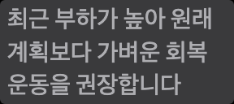
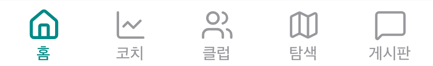
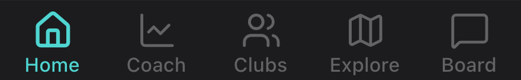
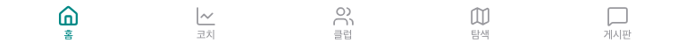
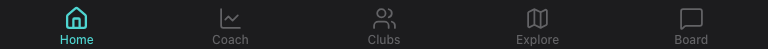

# 웹 E2E 현재 계약 정리 (#1687)와 하단 탭 판정 (#1688)

## #1687: 분류와 유지하는 검증

최초 기록 `20261117-000909-f928`는 웹 `4388c1d6`의 216개 결과(85 PASS, 99 FAIL, 32 N/A)다. 이후 화면과 서버 계약을 읽고 다음과 같이 정리했다. 실패를 skip/PASS로 바꾸거나 visual guard의 12px·44px 기준을 낮추지 않았다.

| 최초 분류 | 현재 검증 |
| --- | --- |
| 로그인·홈·탐색·탐색 구조 36건 | 실제 로그인 CTA, 더보기 검색, 현재 브랜드 소개, 세그먼트 타일 JSON 검색/필터, 다섯 허브의 지역화된 경로, 펼치는 정책 메뉴, link/aria-current 의미를 검사한다. 1024px 미만의 태블릿도 하단 탐색을 쓴다. |
| 전용 설정 22건 | 러닝과 클럽 관전만 각각 기존 `e2e/running-parity.config.ts`, `e2e/club-spectator.config.ts`로 분리한다. 훈련 결정은 기본 목록에 남겨 아래 현재 계약으로 재작성했다. |
| 공개 상세·코치 10건 | 공개 상세 플래그를 명시하여 실제 callable로 타인 활동·댓글을 읽는다. 댓글/활동의 `deletedAt: null`, 네이티브 작성 메모, metrics 소유자 바인딩을 시드한다. 비공개 활동은 실제 403/PERMISSION_DENIED와 본문 부재까지 확인한다. 코치는 현재 대화 경로와 선택된 보조 탐색, 긴 답변의 영역·스크롤·입력기 위치를 검사한다. |
| 언어 전환 3건 | 종료되지 않는 연결을 기다리는 networkidle 대신 더보기의 실제 English 라디오를 선택하고 URL과 html lang을 확인한다. |

현재 홈은 활동 피드이며 옛 실행 카드를 표시하지 않는다. 컨디션은 진단 화면이다. 계획의 훈련 결정 카드는 현재 실행안과 권고 및 적용된 읽기 모델을 보여주며, 옛 `surface="today"` 전용 적용·실행 버튼을 요구하지 않는다. 계획 카드는 실제 활성 목표를 전제로 검증하고, px 기반 글자 토큰을 두 배로 키운 뒤 실제 확대와 재배치를 확인한다. 기존 실행/제안 상태 계약의 단위 검증은 `TrainingExecutionPanel.test.tsx`, `useTrainingProposalController.test.tsx`, `TodayTrainingDecisionCard.test.tsx` 등에 남는다.

코치·훈련 결정의 AI HTTP 응답은 버전 계약 fixture로 고정한다. Auth·공개 활동·댓글·권한 거부는 실제 로컬 Functions·Firestore 에뮬레이터를 사용한다.

기본 목록은 탐색 검색·필터의 중복 한 건과 색상 두 검사의 중복을 합치고 전용 설정 12개 인스턴스를 분리하여 198개다. N/A는 다른 프로젝트에서 같은 검사가 실제 실행된 경우에만 인정하며 PASS에 합산하지 않는다. 러닝은 전용 두 프로젝트 6개, 클럽 관전은 세 프로젝트 3개를 별도 보고한다.

코치 긴 답변은 테스트 변경 외에 실제 제품 오류도 있었다. 보존 허브 래퍼가 높이를 전달하지 않아 입력기가 푸터 밖으로 넘쳤다. 데스크톱에서 높이를 전달하고 보조 탐색 아래 남은 공간을 대화에 배정하여 기존 경계 검사를 유지했다.

## #1688: 10px의 의도와 최종 판정

10px는 `a36eec7c`의 네이티브 HIG 탭 막대 이식에서 의도적으로 도입됐다. 현재 웹의 공통 정책은 다르다. `src/theme/tokens/typography.ts`는 Caption 2(11px)를 램프에서 제외하고 Caption 1(12px)을 최소 단계로 쓴다. `src/theme/README.md`도 최소 12px와 공통 글자 토큰 사용을 명시한다. 실물 `/design-system-controls.html`도 확인했다.

따라서 하단 라벨을 웹의 `var(--fs-2xs)`(12px)로 맞춘다. 네이티브 규격만을 이유로 웹 검사에 예외를 추가하지 않는다. 탭은 페이지 간 이동 link이며 선택 상태는 aria-current로 검사한다.

`responsive.spec.ts`에서 320/390/768px, 한국어·영어, 밝은·어두운 테마의 다섯 링크를 확인한다. 라벨 12px 이상, 글자 잘림 없음, 각 링크 44px 이상, 선택 상태 한 개를 검사하고 실제 막대 이미지를 첨부한다. 기존 visual guard의 전체 38개 화면 검사와 최초 실패했던 28개 인스턴스는 별도로 확인한다.

12px 이후 드러난 작은 터치 영역은 기준을 낮추지 않고 보완했다. 공통 입력/선택 컨트롤의 모바일 높이, 필터 칩의 실제 높이, 도움말·해결 문구·설정 링크의 기존 `ds-tap-target`을 사용한다. 입력 48px 정책은 기존 디자인 시스템 문서에 이미 정의되어 있다.

## 재현과 증거

기본 목록은 앱 저장소의 표준 Lab을 사용한다. Lab은 폐기용 체크아웃에서만 demo 프로젝트/포트를 주입하고 브라우저 외부 호스트를 차단한다.

```sh
python3 tools/e2e-lab/lab.py run --app-ref dev --server-ref dev \
  --web-ref <검증할-원격-브랜치> --suites web-all --server-slot 2
```

전용 러닝은 같은 백엔드 dev의 Functions·Auth·Firestore·Storage를 `demo-orider-running-parity`로 실행한다. 검증용 폐기 체크아웃에서만 fixture의 loopback 포트, 보고서와 App Check 헤더를 주입하고 기존 전용 설정의 Chrome·두 화면 크기를 유지한다. 클럽 관전은 기존 SwiftShader 설정과 세 화면 크기를 유지한다. 테스트 본문을 임시로 바꿔 통과시키지 않는다.

모든 실행의 제품·테스트 소스는 `21602ced581c704fd06127ee84322df304c318b5`, 서버는 `0c05f797ffd32068c49c2aefd98dc11e4568ce4d`다. 아래 결과를 고정한 후 문서·스크린샷만 추가했다. 운영 계정·데이터·배포는 검증 대상이 아니다.

| 실행 | 결과 |
| --- | --- |
| `followup-web-1687-20261117-r11` 기본 목록 | 164 PASS · 0 FAIL/BLOCKED · 34 N/A (전체 198) |
| 동일 소스 전용 러닝 | 6 PASS · 0 FAIL/SKIP |
| 동일 소스 전용 클럽 관전 | 3 PASS · 0 FAIL/SKIP |
| 기존 visual guard | 38 PASS · 0 FAIL, 최초 #1688의 28개 인스턴스 모두 포함 |
| 하단 탐색 확대 전 기본 글자/터치 검증 | 12개 크기·언어·테마 조합 PASS |
| 공통 Chip wrap | 관련 단위 65 PASS · 실물 카탈로그 100%/200%, 밝음/어두움 4 PASS |
| Node 22 정적 검사 | lint:budget, quality:budget, E2E 모드 build 통과 |

러닝 레인에서 드러난 별도의 제품 예외도 수정했다. 선택적 피트니스 문맥 응답에 points가 아직 없을 때 소유자 활동 상세가 `.slice()`에서 실패했으며, 그 상태를 없는 문맥으로 처리한다. 같은 실제 에뮬레이터의 소유자 예정 훈련·읽기 전용 미리보기와 비소유자 비노출 검사로 확인했다.

공개 피드의 Discovery 매핑은 원본 요약의 민감한 수치를 복원하지 않는다. 러닝 테스트는 공개 카드의 정본 페이스·획득고도와 원본 파워 폴백 부재를 검사한다. 허가된 공개 상세에서는 펼친 지표의 `191 spm`·`264 W`, 21개 스플릿·키보드 이동·러닝 전용 분석을 별도로 검사한다.

자동 리뷰의 공통 컨트롤 소유권 지적은 `Chip wrap` 옵션, 공통 CSS, 컴포넌트 문서와 실물 카탈로그로 반영했다. 기능의 `.ds-chip` 재정의는 제거했다. 기본 한 줄·선택 상태·키보드 동작은 유지되며 긴 정보 태그만 옵션으로 줄바꿈한다.








정규화된 수치와 소스는 [verification.json](verification.json)에 기록했다. 원본 JSON·JUnit·스크린샷은 `~/.orider/e2e-lab/runs/followup-web-1687-20261117-r11/`, 전용 실행 로그와 러너는 로컬 `artifacts/followup-five-20261117/`에 있다.
